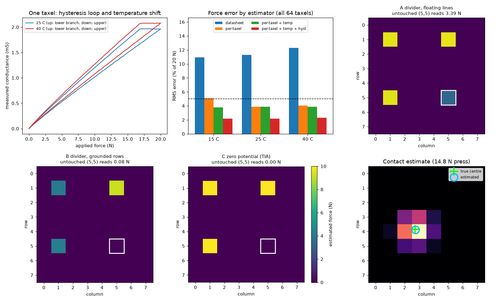

# Tactile Sensor Array: Readout Circuit, Calibration and Fault Analysis

[](https://github.com/vansh0906/tactile-sensor-array-sim/actions/workflows/ci.yml)

A simulated **8 × 8 tactile sensor** for a robot fingertip (4 mm pitch, 64 piezoresistive taxels), taken through the steps a sensor integration engineer owns: **sensor modelling, readout-circuit design, calibration, characterization, fault injection and a fault tree**, each checked against a written requirement. CI fails if any requirement fails.



## What's inside

| Part | What it does |
|---|---|
| `sensor.py` | Force-sensitive-resistor taxel model: power-law response, part-to-part spread, **hysteresis** (play operator), **creep**, **temperature drift**, open and shorted taxels |
| `circuit.py` | DC circuit solver (modified nodal analysis) that reads and writes **SPICE netlists**, so the same circuits can be run in LTspice |
| `readout.py` | Three scan circuits for a row/column array: two resistor-divider designs and a **zero-potential** design with one transimpedance amplifier per column, a 12-bit ADC model and frame timing |
| `calib.py` | Bench calibration of every taxel against a reference load cell at 25 °C and 40 °C; four force estimators from "datasheet curve" to "per-taxel + temperature + hysteresis compensation" |
| `diagnostics.py` | Run-time self-tests (reference row and column, saturation, frozen data, dead-taxel check) and fault-injection campaigns |
| `run_all.py` | All experiments, the requirement table, `results.png` and the netlists in `spice/` |
| `tests.py` | 15 checks: solver against hand results, netlist round trip, fast solver against the full netlist, calibration recovering known parameters, monitor behaviour |

## Design

```
            columns: every line held at 0 V by its own TIA (virtual ground)
                 c0     c1   ...   c7     REF (1 kΩ per row)
 row 0 ──30Ω──┬──R00────R01── ... ─R07────Rref       driven rows: 3.3 V when selected,
 row 1 ──30Ω──┼──R10────R11── ... ─R17────Rref       0 V otherwise
  ...                                                   
 row 7 ──30Ω──┴──R70────R71── ... ─R77────Rref
 REF row ─────── 1 kΩ to every column (self-test)
                 │      │           │      │
                TIA    TIA   ...   TIA    TIA   (Rf 330 Ω) ──► 12-bit ADC
```

- **Why zero potential:** in a passive matrix, current from the selected row can sneak through three pressed taxels and light up a fourth one nobody touched (a "ghost"). Holding every column at virtual ground and every unselected row at 0 V leaves no voltage across any sneak path.
- **Ratiometric readout:** each row's taxels are divided by that row's 1 kΩ reference reading, so supply droop and the row driver's voltage drop under load cancel out.
- **Self-test:** a reference row and column give every row and column line a known reading on every frame. Losing one is flagged in 2 ms.
- **Calibration model:** `log G = c_T + n log F + b s`, where `s` is +1 while loading and −1 while unloading. One least-squares fit per taxel gives the exponent, the hysteresis width and the temperature coefficient.

## Results

<!-- results:start -->
### Requirements (all checked in CI)

```text
ID   Requirement                                              Result      Limit    Status
R1   Force error at 25 C, 0.5-20 N                               2.15 %FS  <= 5.0   PASS
R2   Force error at 15 C and 40 C (temperature compensated)      2.30 %FS  <= 5.0   PASS
R3   Ghost reading on untouched taxels (zero potential)          0.00 %FS  <= 1.0   PASS
R4   Crosstalk on pressed taxels (zero potential)                0.02 %    <= 1.0   PASS
R5   Full frame time incl. reference row and column              0.74 ms   <= 1.0   PASS
R6   Contact location error (RMS)                                0.25 mm   <= 1.0   PASS
R7   Total contact force error (RMS)                             3.58 %    <= 10.0  PASS
R8   Short, open row, open column, frozen ADC flagged (v2)          3 ms   <= 5     PASS
R9   Open taxel flagged during a 5 N contact (60 non-corner)       32 ms   <= 100   PASS
R10  False flags in 10,000 normal frames                            0      <= 0     PASS
10/10 requirements pass
```

### Full output

```text
[1  Readout circuits: ghosting and loading (no ADC noise, true sensor curve)]
Three taxels pressed at 10 N: (1,1) (1,5) (5,1). Taxel (5,5) is untouched.
  method                        reads on (5,5)  reads on (1,1)
  A divider, floating lines           3.388 N         9.58 N
  B divider, grounded rows            0.082 N         4.13 N
  C zero potential (TIA)              0.000 N         9.93 N
40 random patterns with 3-5 taxels pressed at 2-20 N:
  method                        worst ghost   worst crosstalk on pressed
  (crosstalk = change in a pressed taxel's reading caused by the other pressed taxels)
  A divider, floating lines        23.66 %FS                      0.12 %
  B divider, grounded rows          0.59 %FS                     80.49 %
  C zero potential (TIA)            0.00 %FS                      0.02 %
SPICE netlists written (open in LTspice, run, compare the .op values):
  spice/A_divider_floating.cir   V(out) = 0.967432 V
  spice/B_divider_grounded.cir   V(out) = 0.033527 V
  spice/C_zero_potential.cir   V(o1) = -1.468353 V  V(o5) = -0.000110 V  V(o8) = -1.016636 V

[2  Calibration against the reference load cell (all 64 taxels)]
  exponent n: fitted vs true, mean abs diff 0.007
  temperature coefficient: fitted vs true, mean abs diff 66 ppm/C (true values 2915-4808 ppm/C)
  hysteresis: fitted 7.6 % vs true 7.9 % (array mean)
RMS force error over 0.5-20 N, % of full scale (20 N), new random load profiles:
  estimator                     15 C    25 C    40 C
  datasheet                    10.92   11.29   12.30
  per-taxel                     5.08    3.89    4.04
  per-taxel + temp              3.78    3.89    3.89
  per-taxel + temp + hyst       2.18    2.15    2.30
  Hysteresis (mean up/down gap, 0-20-0 N): 7.6 %FS static, 2.2 %FS with compensation
  Creep: 10 N held 60 s, reading rises 4.2 % from t = 1 s to t = 60 s (not compensated)

[3  Scan timing (8 us ADC conversion, 10 us TIA settling per row, 2 us mux settling)]
  divider (64 conversions)                         640 us  ->  1563 Hz
  zero potential, reference column (8 x 9)          656 us  ->  1524 Hz
  zero potential, reference row + column (9 x 9)    738 us  ->  1355 Hz

[4  Contact location and total force (300 presses, 4 mm pitch, Gaussian footprint sigma 3 mm)]
  location error (force-weighted centroid): RMS 0.25 mm, 95th percentile 0.48 mm
  total force, sum of taxels: RMS error 19.1 %, mean -16.7 % (taxels below the 0.2 N activation force are lost)
  total force after contact-level calibration (total = 1.026 x sum + 1.06 N, fit on a separate 100-press set): RMS error 3.6 %, worst 14.2 %

[5  Fault injection (1 kHz frames)]
  design v1 (ref col only): detected within 50 ms (worst latency)
    shorted taxel        100 % of 64 cases   worst 2 ms
    open row line        100 % of  8 cases   worst 2 ms
    open column line       0 % of  8 cases   worst - ms
    frozen ADC           100 % of 10 cases   worst 3 ms
  design v2 (ref row + col): detected within 50 ms (worst latency)
    shorted taxel        100 % of 64 cases   worst 2 ms
    open row line        100 % of  8 cases   worst 2 ms
    open column line     100 % of  8 cases   worst 2 ms
    frozen ADC           100 % of 10 cases   worst 3 ms
  open taxel, 5 N press centred on it: 100 % of 60 non-corner taxels, worst 32 ms after contact starts
  open taxel under 2 s of random contacts: flagged in 28 % of 64 cases
  false flags in 10,000 frames of normal contacts at 30 C: 0

[6  Fault tree: undetected wrong force data (failure rates are assumed, in FIT = failures per 1e9 h)]
  TOP: wrong force data reaches the controller without a fault flag  (OR gate)
  design v1 (ref col only): total 628 FIT, residual undetected 310 FIT (diagnostic coverage 51 %)
     +- open taxel        64 x  5 FIT =  320   coverage  28.1 %   residual  230.0 FIT
     +- shorted taxel     64 x  2 FIT =  128   coverage 100.0 %   residual    0.0 FIT
     +- open row line      8 x 10 FIT =   80   coverage 100.0 %   residual    0.0 FIT
     +- open column line   8 x 10 FIT =   80   coverage   0.0 %   residual   80.0 FIT
     +- frozen ADC         1 x 20 FIT =   20   coverage 100.0 %   residual    0.0 FIT
  design v2 (ref row + col): total 628 FIT, residual undetected 230 FIT (diagnostic coverage 63 %)
     +- open taxel        64 x  5 FIT =  320   coverage  28.1 %   residual  230.0 FIT
     +- shorted taxel     64 x  2 FIT =  128   coverage 100.0 %   residual    0.0 FIT
     +- open row line      8 x 10 FIT =   80   coverage 100.0 %   residual    0.0 FIT
     +- open column line   8 x 10 FIT =   80   coverage 100.0 %   residual    0.0 FIT
     +- frozen ADC         1 x 20 FIT =   20   coverage 100.0 %   residual    0.0 FIT
```
<!-- results:end -->

## Run it

```bash
python3 -m venv .venv && source .venv/bin/activate
pip install -r requirements.txt
python tests.py                       # a few seconds
python run_all.py | tee results.txt   # about a minute; prints everything, saves results.png and spice/*.cir
python tools/readme_results.py        # copies the results into this README
```

## Check the circuits in LTspice

`run_all.py` writes the three readout circuits as netlists with the scenario from the ghost test (three taxels pressed at 10 N, taxel (5,5) untouched and selected):

| File | Circuit | Compare |
|---|---|---|
| `spice/A_divider_floating.cir` | divider, unselected lines floating | `V(out)` |
| `spice/B_divider_grounded.cir` | divider, unselected rows grounded | `V(out)` |
| `spice/C_zero_potential.cir` | zero potential, row 5 selected | `V(o1)`, `V(o5)`, `V(o8)` |

Open a file in LTspice (File → Open, file type "Netlists"), click Run, and read the operating point. The Python value is in the comment at the top of each file.

## Limitations

- Simulation only. The taxel parameters are in the range of published FSR datasheet curves but are not a specific part, and the contact footprint is an idealised Gaussian.
- DC circuit model: no line capacitance or op-amp bandwidth in the solver; settling is a fixed budget per step in the timing estimate. Op-amp saturation is modelled as an ADC clip only.
- The fault-tree failure rates are assumed values for illustration; the diagnostic coverage numbers come from the fault-injection runs.
- Creep is measured but not compensated.
